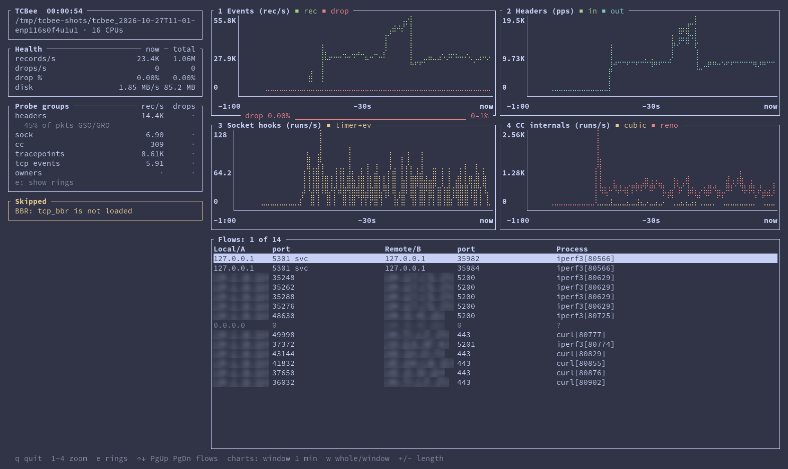
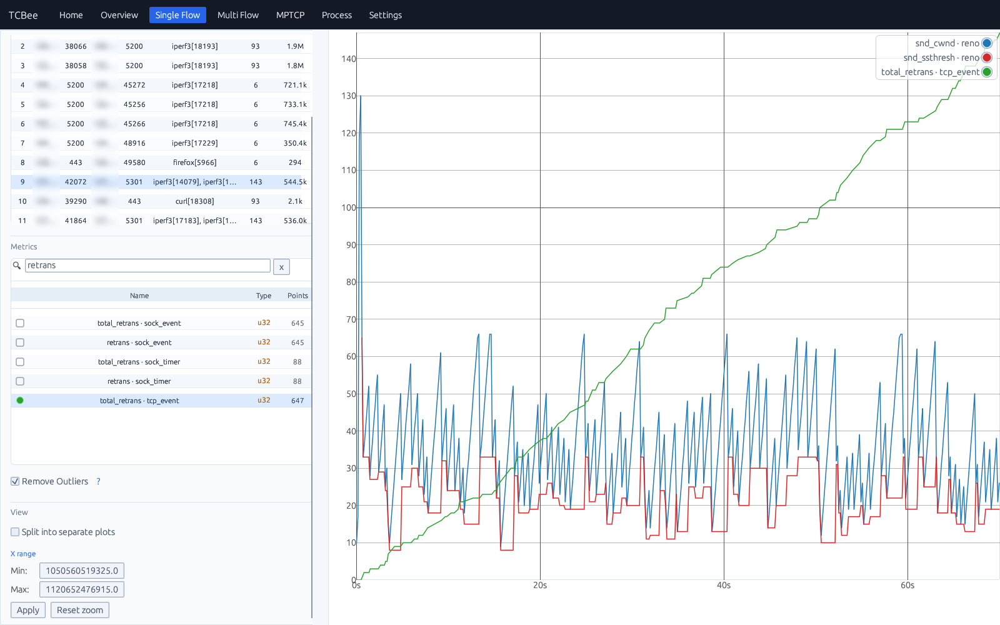
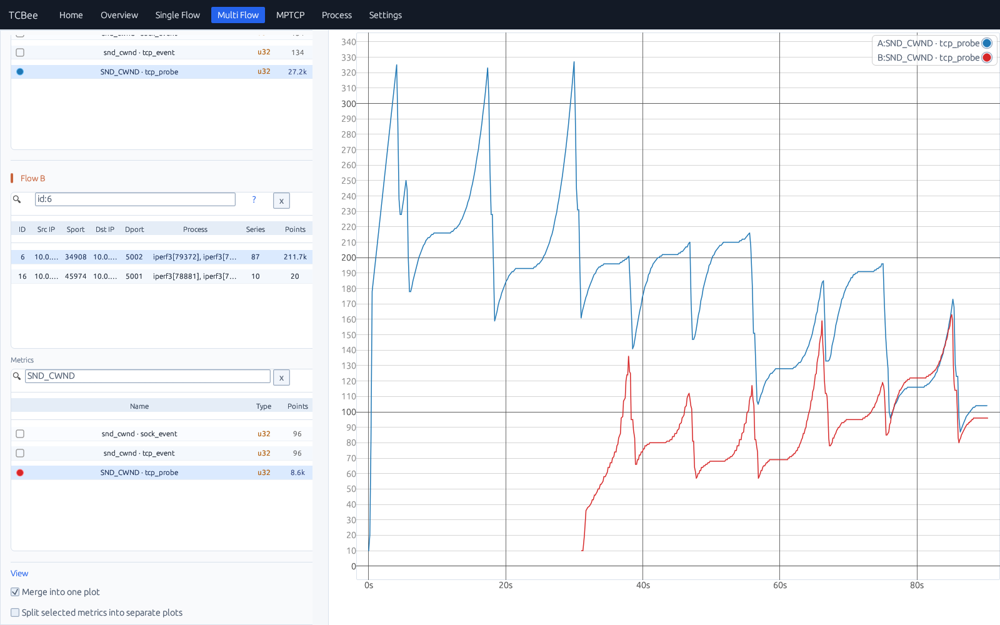

<div align="center">
 
 <h2>TCBee: TCP Flow Analysis with eBPF</h2>

    [](https://github.com/uni-tue-kn/TCBee/actions/workflows/tcbee.yml)

 
</div>

TCBee monitors TCP flows at up to 5M events/s. It records packet headers and kernel TCP state with eBPF, stores them in a DuckDB or SQLite database and plots them. Linux only.

## Quick Start

`tcbee-record` writes raw `*.tcp` files, `tcbee-process` turns them into a database, and `tcbee-viz` plots it. Download `tcbee-<tag>-linux-x86_64.tar.gz` from the [releases page](https://github.com/uni-tue-kn/TCBee/releases) and install it to `/usr/local/bin`:

```bash
tar xzf tcbee-<tag>-linux-x86_64.tar.gz
sudo tcbee-<tag>-linux-x86_64/install.sh     # PREFIX=... for another place, --uninstall to remove
```

Requirements:

- Linux on x86_64, kernel 5.12 or newer with BTF (`/sys/kernel/btf/vmlinux`). Root for `record` and `live`.
- glibc. On much older distributions, [build from source](#building-from-source).
- For `tcbee-viz`, a display with OpenGL (X11 or Wayland). If it does not start, see [its runtime requirements](tcbee-viz/README.md#runtime-requirements).

Record the packet headers on `eth0` and the socket state of the flows on port 5201 (e.g. an `iperf3` test), stop with Ctrl+C, then process and open the recording:

```bash
sudo tcbee record -h eth0 -k -p 5201
tcbee process -o /tmp/myflow.duck
tcbee viz /tmp/myflow.duck
```

In the viewer, open *Single Flow*, pick a flow and tick `snd_cwnd`. The recording lands in `/tmp/tcbee_<timestamp>/`, and `process` picks the newest one. `tcbee <command>` runs the matching `tcbee-*` tool; `tcbee --help` lists them. On RHEL, Rocky and Alma, `sudo` does not search `/usr/local/bin`, so run `sudo /usr/local/bin/tcbee record ...` there.

## The tools

### tcbee-record

Records what you select with one or more source flags:

| Flag | Records |
|---|---|
| `-h IFACE` | Packet headers (TC; `--headers-at driver` for XDP) |
| `-t` | TCP tracepoints: `tcp_probe`, retransmissions, resets, state changes |
| `-k` | Full socket state at timers and TCP events |
| `-w` | Congestion window only (lowest overhead) |
| `-a` | Cubic, BBR and Reno internals |
| `-m` | MPTCP path manager events and subflows |

```bash
sudo tcbee record -w -p 5201 --duration 30                  # cwnd of port 5201 for 30 s
sudo tcbee record -k -a -p 5201                             # socket state and CC internals
sudo tcbee record -k --on-change cc                         # write only when the CC state changes
sudo tcbee record -k --ports 80,443 --ips 10.0.0.1          # several ports and hosts
sudo tcbee record -h eth0 -k -q --duration 60 --metadata    # no terminal UI, with host metadata
sudo tcbee record -k -d ~/rec                               # write to ~/rec instead of /tmp
```

`tcbee record --help` lists all flags. Filters, on-change mode, process owners and kernel requirements are in [tcbee-record/README.md](tcbee-record/README.md).

### tcbee-process

Converts a recording into a database. The extension of `-o` picks the engine: `.duck`/`.duckdb` for DuckDB, `.sqlite`/`.db` for SQLite.

```bash
tcbee process -o /tmp/myflow.duck                              # newest recording in /tmp
tcbee process -s ~/rec -o /tmp/myflow.sqlite -f                # newest in ~/rec, replace the output
tcbee process -s /tmp/tcbee_2026-10-05T18-16-22 -o /tmp/a.duck # one specific recording
```

An existing output file is only replaced with `-f`. More in [tcbee-process/README.md](tcbee-process/README.md).

### tcbee-viz

Plots one flow, compares two, and adds derived series such as retransmissions or bytes in flight through plugins. Recordings made with `-m` get an MPTCP tab, and the flow table filters by tuple or process (`dport:5201`, `proc:iperf3`).

```bash
tcbee viz /tmp/myflow.duck    # or start without an argument and open a file from Home
```

To try it without root, process the small recording in the repository: `tcbee process -s tcbee-process/tests/fixtures/tcbee_small -o /tmp/small.duck`. Tabs and filter syntax are in [tcbee-viz/README.md](tcbee-viz/README.md).

### tcbee-live

A live congestion window monitor with a GUI that writes no files. It needs Linux 5.8 or newer with BTF. See [tcbee-live/README.md](tcbee-live/README.md).

```bash
sudo tcbee live --select-port 5201
```

## Building from source

Building needs Rust stable 1.82 or newer ([rustup.rs](https://rustup.rs/)) and these Debian/Ubuntu packages:

```bash
sudo apt install -y clang libclang-dev libelf-dev zlib1g-dev pkg-config make \
    libsqlite3-dev fontconfig libfontconfig1-dev libgl-dev libegl-dev
```

Build all tools into `bin/` and install them to `/usr/local/bin`:

```bash
make
sudo make install    # PREFIX=... and DESTDIR=... as usual; make uninstall removes them
```

`make record process viz` leaves out `tcbee-live`. To run without installing, call `./bin/tcbee`.

DuckDB is compiled from source on the first build, which takes about ten minutes. To skip it, build with `make record process viz CARGO_FLAGS="--no-default-features --features sqlite"` and write `.sqlite` files. Cargo features and DuckDB linking options are in the [tcbee-process Building section](tcbee-process/README.md#building).

## Reading the data yourself

The database is a plain SQLite or DuckDB file. Rust programs can use the `ts-storage` library, see [ts-storage/README.md](ts-storage/README.md), which also lists the tables and columns. [examples/db/](examples/db/) has Python scripts that list flows and plot the congestion window, and [examples/raw/](examples/raw/) reads the raw `*.tcp` files.

## Testing

[testing/](testing/) has a Mininet setup with a bottleneck topology that drives `iperf3` traffic through the tools. Start it with `python3 testing/run.py`. Prerequisites and menu options are in [testing/README.md](testing/README.md).

## Screenshots

<picture>
 <source media="(prefers-color-scheme: dark)" srcset="imgs/visualize-single-dark.png"/>
 
</picture>
<picture>
 <source media="(prefers-color-scheme: dark)" srcset="imgs/visualize-multi-dark.png"/>
 
</picture>

## License and credits

MIT, see [LICENSE](LICENSE). Special thanks to [Evelyn](https://github.com/ScatteredDrifter) and Lars for their support during development.

*Developed with AI coding assistance. All code reviewed and verified by human developers before inclusion.*
