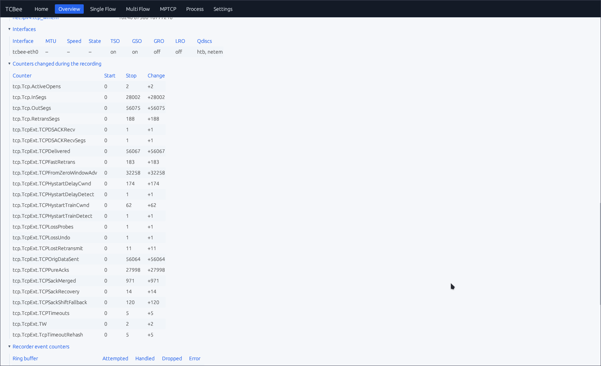
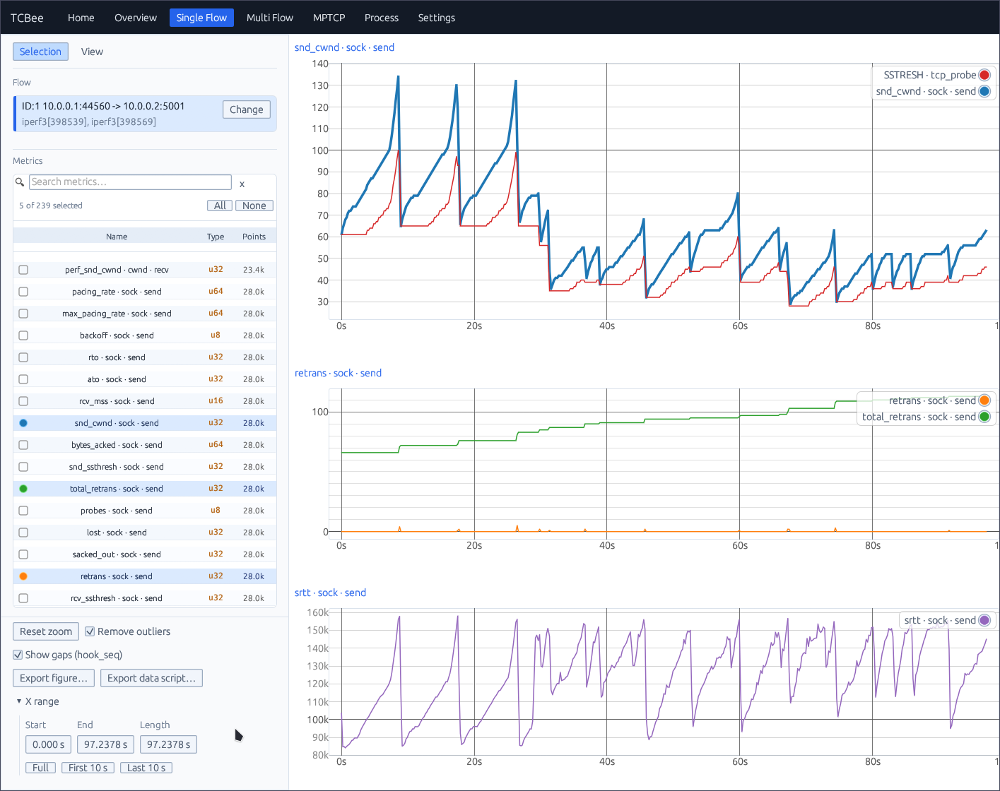
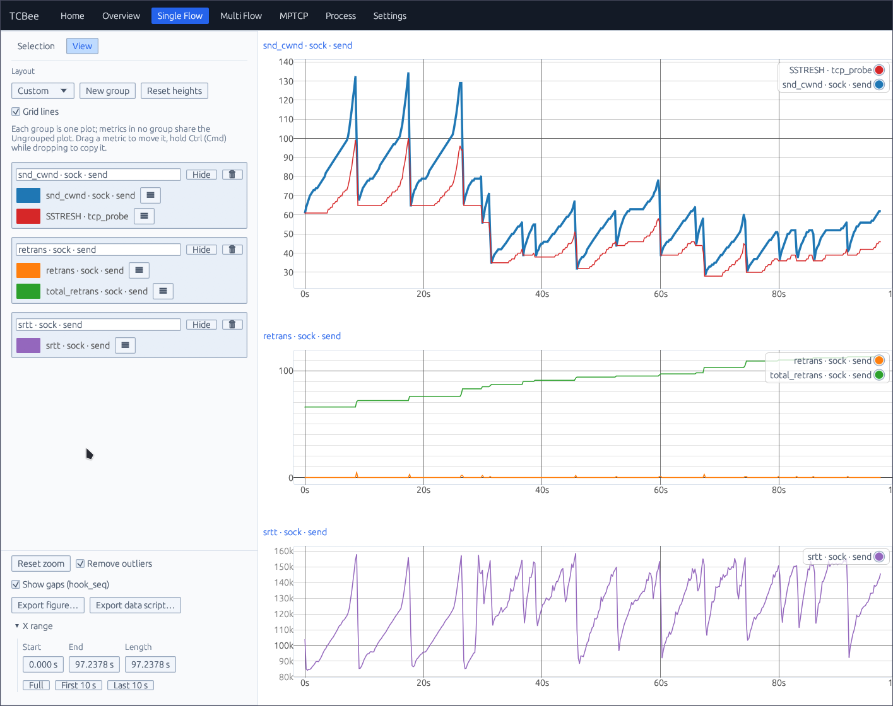
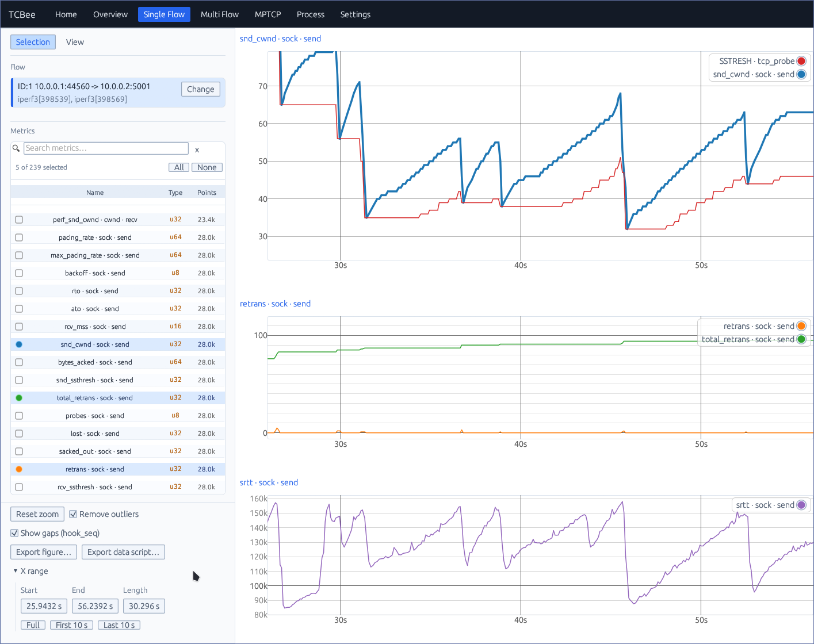
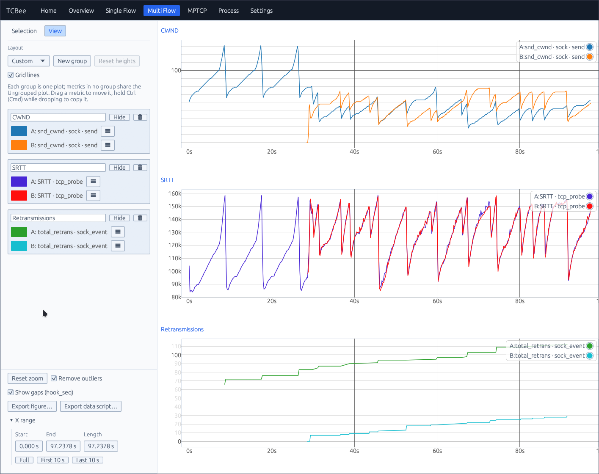
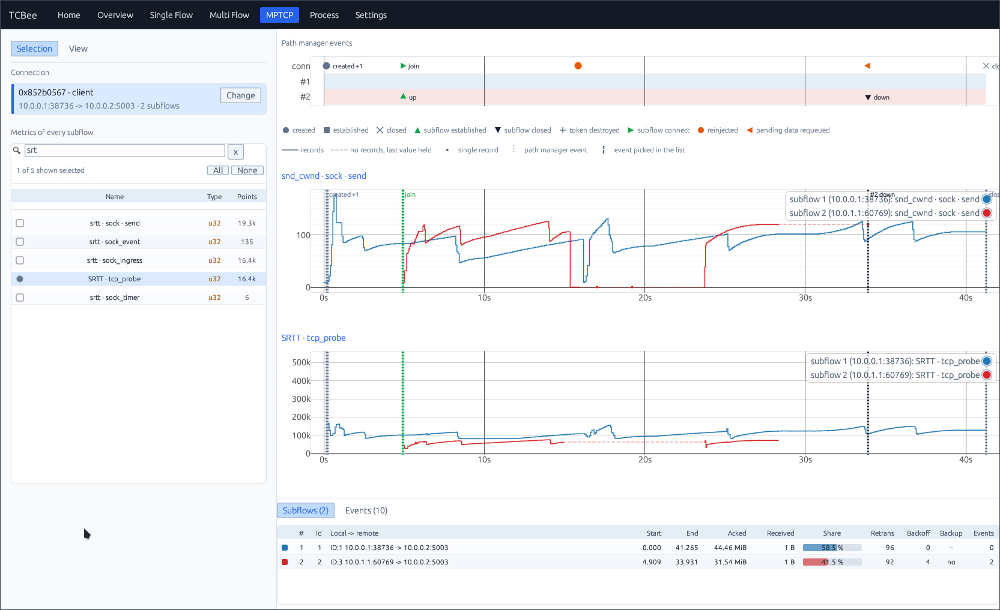
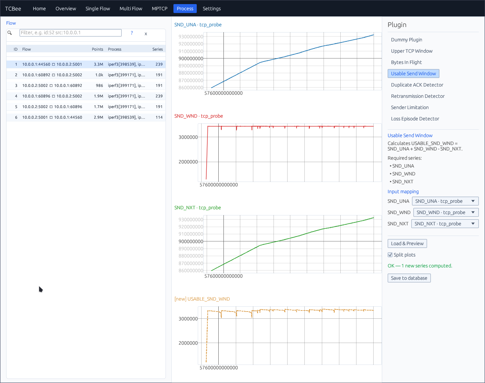
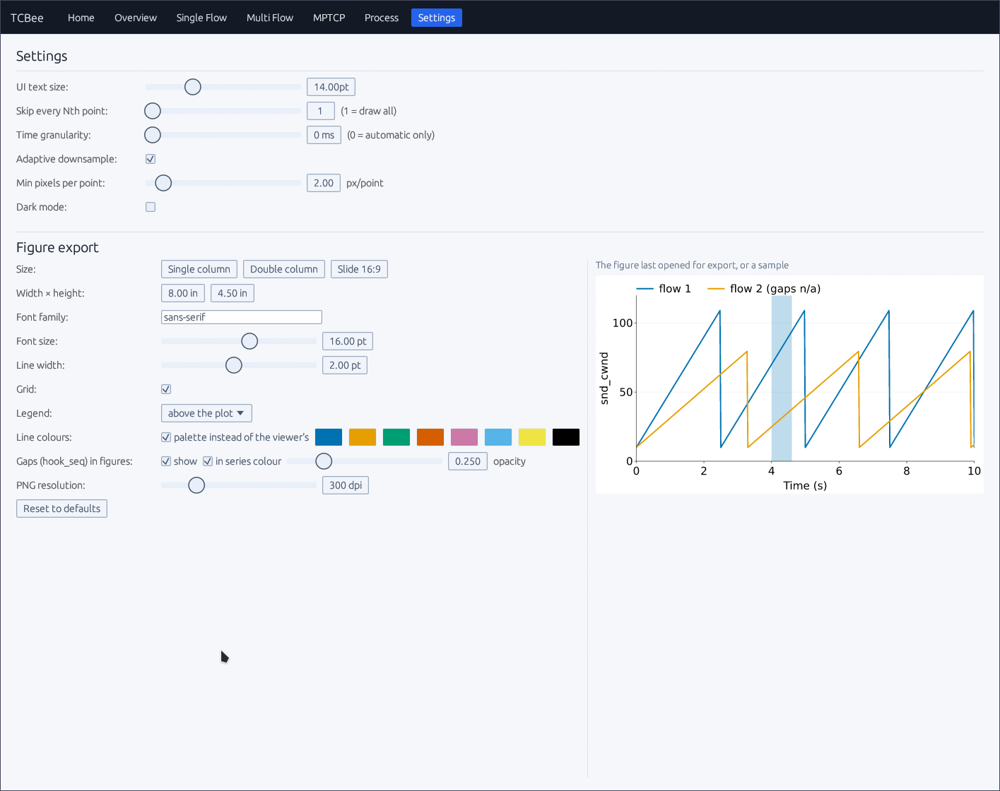

# tcbee-viz

Part of [TCBee](../../README.md). A desktop viewer for the databases that `tcbee-process` writes.

```bash
tcbee-viz /tmp/myflow.duck     # or start without an argument and open a file from Home
```

It takes one database path (`.duck`, `.duckdb`, `.sqlite`, `.db`). `-h` prints the help and `-V` the version, both without opening a window.

## Tabs

| Tab | Shows |
|---|---|
| Home | Opens a database. If the open button is not visible, enlarge the window. |
| Overview | What wrote the database. For recordings made with `tcbee-record --metadata` also the host, kernel, probes, clocks, TCP sysctls, interfaces and the counters that changed during the recording. |
| Single Flow | Pick a flow with *Change* under *Selection* and tick metrics (e.g. `snd_cwnd`) in the metric table. *View* puts metrics into plot groups, one plot each, and sets colours, line widths and grid lines. All plots share one time axis. |
| Multi Flow | Two flows (*Flow A*, *Flow B*) on one time axis, with the same metric table and plot groups. |
| MPTCP | Only for recordings made with `tcbee-record -m`. Pick a connection with *Change* (the filter also takes `token:`, `side:` and `conn:`) and tick metrics; each metric is drawn for every subflow in the subflow's colour, below a lane of the path manager events. A legend explains held values (dashed), single records (dots) and event lines. Below, the subflows with their bytes and share, and a filterable list of the events. |
| Process | Plugins that compute derived series from a flow: bytes in flight, usable send window, duplicate ACKs, retransmissions, sender limitation, loss episodes, upper TCP window. *Load & Preview* plots the result, *Save to database* stores it as new series of the flow. |
| Settings | Text size, downsampling, time granularity, dark mode, and the style of exported figures. |

## Screenshots

The tabs in the order of a typical session.

**Overview.** Host, kernel, interfaces and the TCP counters that changed during the recording.



**Single Flow, metrics.** Pick a flow with *Change*, then tick metrics in the table; each group of metrics gets its own plot.



**Single Flow, view.** The *View* tab arranges metrics into plot groups by drag and drop, sets colours and line widths, and toggles grid lines.



**Zoom.** All plots share one time axis; zooming one zooms all, and *X range* sets the range exactly.



**Multi Flow.** Two flows on one time axis, here two Cubic flows sharing a bottleneck.



**MPTCP.** The metrics of every subflow of a connection, in the subflow's colour, below a lane of path manager events.



**Process.** A plugin computes a derived series, here the usable send window, previews it and saves it to the database.



**Settings.** Viewer options and the default style of exported figures, with a preview.



## Gaps

`tcbee-record` numbers the events of each flow direction at a hook (hook_seq), so an event that was dropped leaves a hole in the numbers.
With *Show gaps* on, the plots shade these holes in the colour of their series; hovering a span shows how many events are missing.
Spans closer than a pixel are merged.
Losses after the last recorded event cannot be seen.
Series recorded with `--no-hook-seq` and derived series have no gap information and are listed as *Gaps n/a*.

## Export

Both plot tabs export what they show: the selected metrics in the visible time range.

- *Export figure…* opens a preview of the figure next to its style, and *Save figure…* writes it as PDF or PNG (by the file extension).
  Style edits in the preview apply to that figure only, unless *Use as default style* keeps them.
  The y-axis label and the legend labels can be replaced there, for that figure only.
  The data is read again from the database at the resolution of the figure, keeping the extremes of each column; leading outliers are dropped as in the plot.
  Lines and gaps keep their colours from the viewer, unless the style uses its own palette.
  The default style is set under *Settings → Figure export*, with a preview of the figure last opened for export.
  It is saved in `$XDG_CONFIG_HOME/tcbee/viz.toml` (default `~/.config/tcbee/viz.toml`), which can also be edited by hand or kept with a paper.
  The value range of a single plot is kept; split plots fit their data.
- *Export data script…* shows a Python script to copy that loads the same series and their gaps with the [tcbee package](../../python/API.md).
  It has no plotting code: plot with the library of your choice where the script says so.

## Flow filter

The flow table names the process of each flow as `name[pid]`, with the command line on hover, and the MPTCP connection of each subflow.
Plain text in its filter searches all columns and the process names.
`column:value` limits a term, and terms separated by spaces must all match:

```
src:10.0.0.1 dport:5201      id:52   sport:443   port:443   dst:192.168
conn:3      (flows of MPTCP connection 3)
proc:curl   pid:4242   uid:1000   cmd:https   (process name, PID, user, command line)
```

## Runtime requirements

`tcbee-viz` needs a display with OpenGL. It loads the GL, EGL, X11 or Wayland libraries at runtime; on Debian/Ubuntu these are:

```bash
sudo apt install libgl1 libegl1 libxkbcommon0 libxkbcommon-x11-0 libwayland-client0 \
    libx11-6 libxcursor1 libxi6 libxrandr2
```

The Open dialog uses `xdg-desktop-portal` with a desktop backend, or `zenity` if no portal answers.

## Building

`make viz` in the repository root builds it into `bin/`, `sudo make install` installs it. Without DuckDB: `make viz CARGO_FLAGS="--no-default-features --features sqlite"`; opening a `.duck` file then shows an error.
Cargo features and DuckDB linking are described in the [tcbee-process Building section](../tcbee-process/README.md#building).
