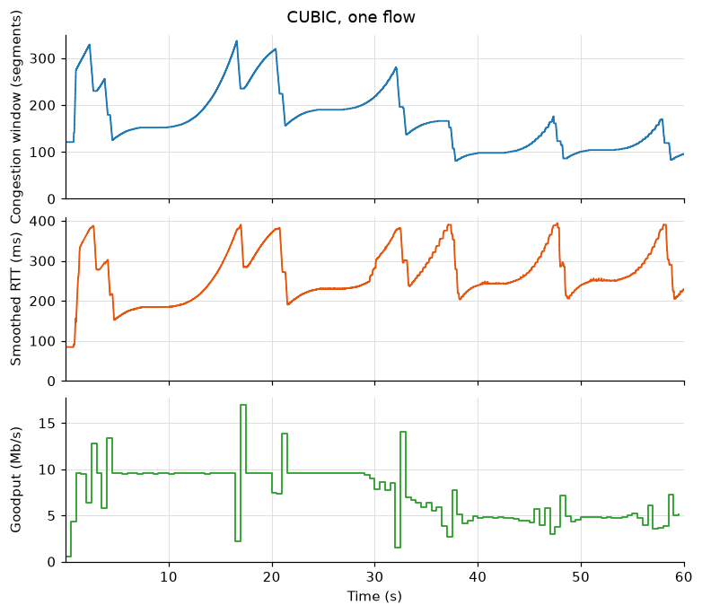
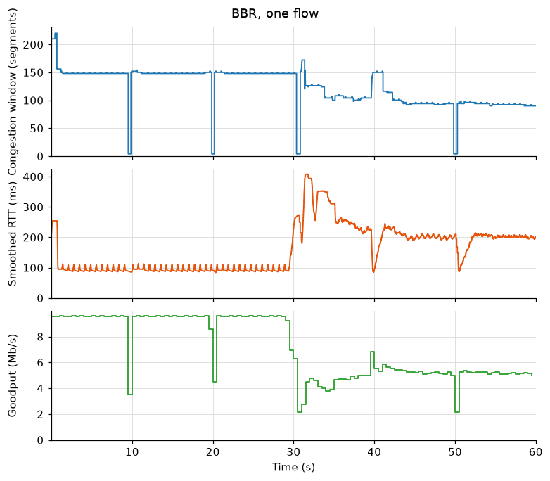
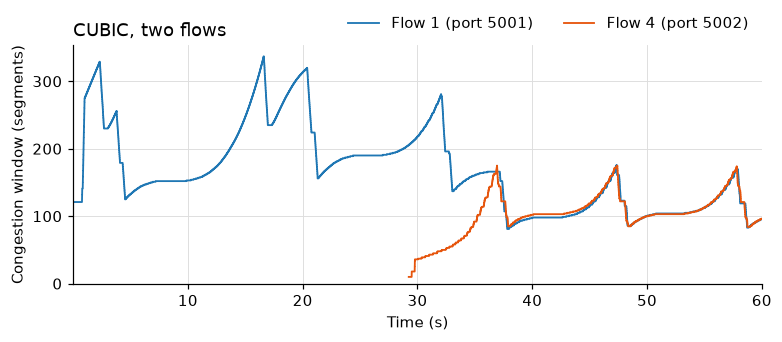
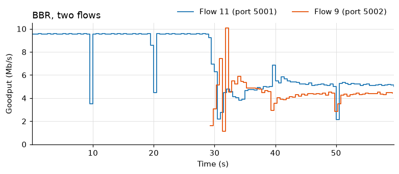

# Examples

Python scripts that read and plot the databases written by `tcbee-process`, in [python/](python/).
They use the [tcbee Python API](../python/README.md). Install it from the repository root:

```bash
python -m pip install './python[duckdb,plot]'
```

## Quick start

```bash
python examples/python/list_flows.py recording.duck          # find flow IDs
python examples/python/plot_metrics.py recording.duck 1      # cwnd, RTT and goodput of flow 1
python examples/python/compare_flows.py recording.duck       # goodput of the two largest flows
```

No recording at hand? Process the test traces: `tcbee-process -s crates/tcbee-process/tests/fixtures/tcbee_small -o /tmp/small.duck`.

Every script takes `--help`, reads SQLite and DuckDB, and saves PNG, SVG or PDF with `--output`.
Without `--output` it opens a window.

## Plots

The plots below come from [testing/](../testing/README.md): two iperf3 transfers share a 10 Mb/s bottleneck with 80 ms RTT, the second starts after 30 s.
They were recorded with `-h tcbee-eth0 -w -t -k -a --metrics`.
`list_flows.py` also shows iperf3's control connections and the ACK direction of each transfer; the flow IDs below are the transfers.

### One flow: `plot_metrics.py`

```bash
python examples/python/plot_metrics.py cubic.duck 1 --title "CUBIC, one flow"
python examples/python/plot_metrics.py bbr.duck 11 --title "BBR, one flow"
```



CUBIC fills the 150-packet queue until it overflows, so the RTT follows the congestion window up to 400 ms.
BBR keeps the queue short; its RTT stays near the base RTT until the second flow starts.
The cwnd and goodput dips at 10, 20, 30 and 50 s are BBR's ProbeRTT phase.
Goodput above 10 Mb/s in the CUBIC plot is real: after a loss, one cumulative ACK covers many segments.



Each `--metric SOURCE.NAME` adds a panel, for example `--metric tcp_probe.SSTRESH --metric bbr.pacing_gain`.
`goodput` is not stored; it is computed from `tcp_probe.SND_UNA` in `--bin` intervals (default 0.5 s).
Use `--start` and `--end` (seconds) to zoom in.

### Several flows: `compare_flows.py`

```bash
python examples/python/compare_flows.py cubic.duck --metric tcp_probe.SND_CWND --title "CUBIC, two flows"
python examples/python/compare_flows.py bbr.duck --title "BBR, two flows"
```





Without flow IDs, the script picks the `--limit` flows (default 2) that sent the most data.
Pass IDs to choose them yourself, or narrow the choice with `--host` and `--port`.
`--align flow` starts each flow at time 0.

### Long recordings: `plot_large_metric.py`

```bash
python examples/python/plot_large_metric.py recording.duck 1 --metric tcp_probe.SRTT --bins 2000
```

Reads the metric in batches and plots the minimum and maximum per time bin, so memory stays small and short spikes stay visible.
Use it when a metric has millions of samples.

### Options

| Option | Meaning |
|---|---|
| `--metric SOURCE.NAME` | metric to plot; `list_flows.py -v` lists those of each flow |
| `--dir send\|recv\|none` | needed for metrics recorded in several directions (`sock`, `cwnd`, `tcp4`) |
| `--bin` | goodput interval in seconds (default 0.5) |
| `--start`, `--end` | time window in seconds |
| `--output FILE` | save as `.png`, `.svg` or `.pdf` |
| `--title`, `--dpi` | figure title and PNG resolution |

Colors, fonts and the axis labels of known metrics are in [`python/_plotting.py`](python/_plotting.py).

## Your own plot

```python
import matplotlib.pyplot as plt
import tcbee

with tcbee.open("recording.duck") as db:
    flow = db.flow(1)
    cwnd = flow.series().one(source="tcp_probe", name="SND_CWND").read_numpy()

plt.step((cwnd["ts_ns"] - flow.start_ns) / 1e9, cwnd["value"], where="post")
plt.xlabel("Time (s)")
plt.ylabel("Congestion window (segments)")
plt.savefig("cwnd.png")
```

See the [API reference](../python/API.md) for all methods.

## More

- [sql/](sql/README.md): database tables and SQL queries, for any SQLite or DuckDB client, without the Python library.
- [raw/](raw/): scripts that read the raw `*.tcp` files of `tcbee-record` without processing them.
