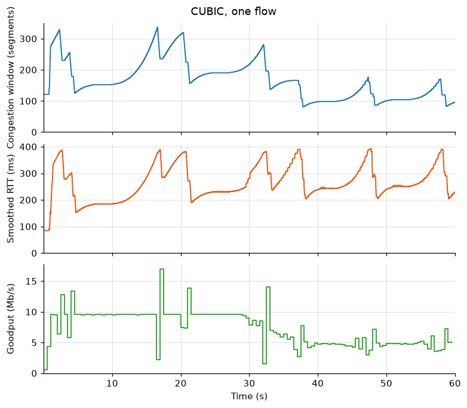
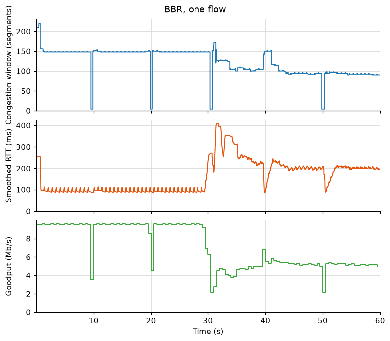
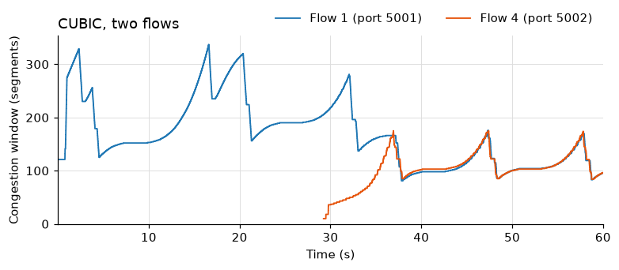
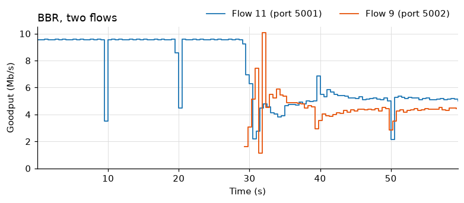

# Database examples

Python scripts that read and plot the databases written by `tcbee-process`.
They use the [tcbee Python API](../../tcbee-python/README.md). Install it from the repository root:

```bash
python -m pip install './tcbee-python[duckdb,plot]'
```

## Quick start

```bash
python examples/db/list_flows.py recording.duck          # find flow IDs
python examples/db/plot_metrics.py recording.duck 1      # cwnd, RTT and goodput of flow 1
python examples/db/compare_flows.py recording.duck       # goodput of the two largest flows
```

No recording at hand? Process the test traces: `tcbee-process -s tcbee-process/tests/fixtures/tcbee_small -o /tmp/small.duck`.

Every script takes `--help`, reads SQLite and DuckDB, and saves PNG, SVG or PDF with `--output`.
Without `--output` it opens a window.

## Plots

The plots below come from [testing/](../../testing/README.md): two iperf3 transfers share a 10 Mb/s bottleneck with 80 ms RTT, the second starts after 30 s.
They were recorded with `-h tcbee-eth0 -w -t -k -a --metrics`.
`list_flows.py` also shows iperf3's control connections and the ACK direction of each transfer; the flow IDs below are the transfers.

### One flow: `plot_metrics.py`

```bash
python examples/db/plot_metrics.py cubic.duck 1 --title "CUBIC, one flow"
python examples/db/plot_metrics.py bbr.duck 11 --title "BBR, one flow"
```



CUBIC fills the 150-packet queue until it overflows, so the RTT follows the congestion window up to 400 ms.
BBR keeps the queue short; its RTT stays near the base RTT until the second flow starts.
The cwnd and goodput dips at 10, 20, 30 and 50 s are BBR's ProbeRTT phase.
Goodput above 10 Mb/s in the CUBIC plot is real: after a loss, one cumulative ACK covers many segments.



Each `--metric SOURCE.NAME` adds a panel, for example `--metric tcp_probe.SSTRESH --metric bbr.pacing_gain`.
`goodput` is not stored; it is computed from `tcp_probe.SND_UNA` in `--bin` intervals (default 0.5 s).
Use `--start` and `--end` (seconds) to zoom in.

### Several flows: `compare_flows.py`

```bash
python examples/db/compare_flows.py cubic.duck --metric tcp_probe.SND_CWND --title "CUBIC, two flows"
python examples/db/compare_flows.py bbr.duck --title "BBR, two flows"
```





Without flow IDs, the script picks the `--limit` flows (default 2) that sent the most data.
Pass IDs to choose them yourself, or narrow the choice with `--host` and `--port`.
`--align flow` starts each flow at time 0.

### Long recordings: `plot_large_metric.py`

```bash
python examples/db/plot_large_metric.py recording.duck 1 --metric tcp_probe.SRTT --bins 2000
```

Reads the metric in batches and plots the minimum and maximum per time bin, so memory stays small and short spikes stay visible.
Use it when a metric has millions of samples.

### Options

| Option | Meaning |
|---|---|
| `--metric SOURCE.NAME` | metric to plot; `list_flows.py -v` lists those of each flow |
| `--dir send\|recv\|none` | needed for metrics recorded in several directions (`sock`, `cwnd`, `tcp4`) |
| `--bin` | goodput interval in seconds (default 0.5) |
| `--start`, `--end` | time window in seconds |
| `--output FILE` | save as `.png`, `.svg` or `.pdf` |
| `--title`, `--dpi` | figure title and PNG resolution |

Colors, fonts and the axis labels of known metrics are in [`_plotting.py`](_plotting.py).

## Your own plot

```python
import matplotlib.pyplot as plt
import tcbee

with tcbee.open("recording.duck") as db:
    flow = db.flow(1)
    cwnd = flow.series().one(source="tcp_probe", name="SND_CWND").read_numpy()

plt.step((cwnd["ts_ns"] - flow.start_ns) / 1e9, cwnd["value"], where="post")
plt.xlabel("Time (s)")
plt.ylabel("Congestion window (segments)")
plt.savefig("cwnd.png")
```

See the [API reference](../../tcbee-python/API.md) for all methods.

## Database schema

Besides the catalog tables there is one table per kind of recorded event, with one row per record. The complete description is in [ts-storage/README.md](../../ts-storage/README.md#database-layout-schema-version-3).

| Table | Content |
|---|---|
| `meta(key, value)` | `schema_version` is `'3'`; also `writer`, `trace_dir`, `created_at` |
| `flows(id, src, dst, sport, dport, l4proto)` | one row per flow; ports are in host byte order |
| `connections`, `connection_flows` | connection groups and time-scoped subflow memberships |
| `flow_owners` | optional timestamped process-owner observations |
| `series(id, flow_id, kind, source, dir, name, value_type, tbl, col, n, t_min, t_max, v_min, v_max)` | one row per series: a column of an event table for one flow and direction, or a series computed in `tcbee-viz` |
| `ev_sock`, `ev_tcp_probe`, `ev_cwnd`, `ev_cubic`, `ev_bbr`, `ev_tcp4`, `ev_tcp6`, `ev_mptcp_pm`, `ev_tcp_event` | the events: `flow_id`, `dir`, `ts`, `seq`, then one column per field |
| `derived_samples(series_id, ts, seq, v_int, v_float, v_bool, v_text)` | the points of derived series |

- `ts` is nanoseconds since boot (the recorder's `bpf_ktime_get_ns()`), `seq` the index of the record in its file. Sort by `ts, seq`.
- `dir` is 0 (no direction: `tcp_probe`, `cubic`, `bbr`), 1 (send) or 2 (receive). `sock`, `cwnd`, `tcp4` and `tcp6` have both.
- `series.kind` is 0 for series of the `ev_*` tables (`tbl` and `col` say where) and 1 for derived series. `n`, `t_min`, `t_max`, `v_min` and `v_max` are precomputed.
- Column names keep their original case (`SND_CWND`, `perf_snd_cwnd`, `bic_K`), so quote them in SQL.
- SQLite stores unsigned 64-bit values as signed integers: `max_pacing_rate` of `u64::MAX` reads as `-1`. DuckDB has unsigned columns.

## Queries

`SELECT` statements for `sqlite3` or the `duckdb` shell. Flow ids are assigned while processing and differ from run to run: look yours up in `flows` (or with `list_flows.py`) and replace the `3` below.

The send-side congestion window of flow 3 over time:

```sql
SELECT ts, snd_cwnd FROM ev_sock WHERE flow_id = 3 AND dir = 1 ORDER BY ts, seq;
```

Several fields of the same record at once, with time in seconds since the flow's first sample:

```sql
SELECT (ts - MIN(ts) OVER ()) / 1e9 AS t, "SND_CWND", "SSTRESH", "SRTT"
FROM ev_tcp_probe WHERE flow_id = 3 ORDER BY ts, seq;
```

Which series does a flow have, and how long are they:

```sql
SELECT source, dir, name, n, t_min, t_max, v_min, v_max
FROM series WHERE flow_id = 3 ORDER BY source, dir, name;
```

The three flows with the most `sock` rows:

```sql
SELECT flow_id, COUNT(*) AS rows FROM ev_sock WHERE dir = 1
GROUP BY flow_id ORDER BY rows DESC LIMIT 3;
```

A series computed in `tcbee-viz` (the point value is in `v_int`, `v_float`, `v_bool` or `v_text`, depending on `series.value_type`):

```sql
SELECT d.ts, d.v_float FROM derived_samples d JOIN series s ON s.id = d.series_id
WHERE s.flow_id = 3 AND s.name = 'my_metric' ORDER BY d.ts, d.seq;
```
